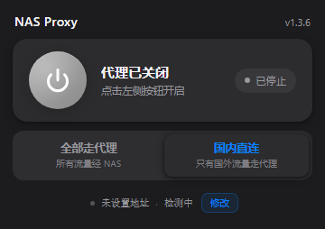
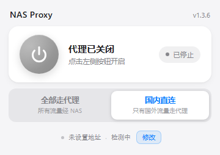

# NASProxyTray
一个常驻托盘的 Windows 系统代理切换工具。**双击托盘图标直接开关代理，右键菜单完成一切日常操作**——日常甚至不需要打开界面。

深色模式｜浅色模式（跟随系统）：

|  |  |
|---|---|


---

## ✨ 功能

- 🔄 **一键切换系统代理**：双击托盘图标直接开 / 关，不必打开界面
- 🎨 **一屏到底的界面**：360px 单屏，只有「开关 + 模式 + 地址」，永不滚动
- 🇨🇳 **国内直连分流**：内置 703 条国内域名 + 全部 `.cn` 直连，其余交给你的代理
- 🔀 **两种模式**：全部走代理 / 国内直连（托盘菜单一点即切）
- 📥 **规则可更新可自定义**：菜单一键联网更新，或手工加几行自己的域名，改完自动生效
- 🌙 **静默开机自启**：开机只留托盘图标，不弹面板
- 🛡️ **开机探测保护**：NAS 没醒就不开代理，避免「一开机全家断网」
- 🖥️ **高 DPI 清晰**：声明 Per-Monitor V2，4K / 200% 缩放下界面与托盘图标都锐利
- 🔔 **检查更新**：启动后静默检查新版本，托盘菜单里也能手动检查
- 📦 **单文件**：v1.2.0 起依赖全部打进 exe，不必再带 `lib\` 与 `ui\`
- 🪶 **轻量常驻**：托盘运行，占用低
- 🚀 **免安装**：绿色版，解压即用

---

## 📋 系统要求

| 项目 | 要求 |
|---|---|
| 操作系统 | Windows 10 1809 及以上 / Windows 11 |
| 运行时 | **Microsoft Edge WebView2 Runtime**（见下方说明） |
| 从源码运行 | PowerShell 5.1（系统自带） |

### ⚠️ 关于 WebView2 Runtime

本程序的界面依赖 WebView2 运行时。**大多数 Win11 和已安装新版 Edge 的 Win10 已经自带**。
如果没有，界面会白屏或报错，请安装一次（装完永久有效）：

👉 **下载地址**：<https://go.microsoft.com/fwlink/p/?LinkId=2124703>

> 装完不需要重启，直接再打开程序即可。

---

## 🚀 快速开始（普通用户）

### 方式一：下载免安装版（推荐）

1. 到 [Releases](../../releases/latest) 下载 `NASProxyTray-v1.3.6.zip`
2. 解压到任意目录（**不要放在需要管理员权限的目录**，比如 `C:\Program Files`）
3. 双击 `NASProxyTray.exe`
4. 托盘出现图标 → 单击 = 打开界面（双击 = 直接切换代理）

> **v1.2.0 起是单文件**：`lib\` 与 `ui\` 已经打进 exe 内部，首次运行会释放到
> `%LOCALAPPDATA%\NASProxy\runtime\<版本>\`，之后启动直接复用。
> 所以 exe 可以随便移动、随便改名，不必再和目录一起带着走。
>
> **v1.2.1 起所有运行时数据都放在 `%LOCALAPPDATA%\NASProxy\`**（日志、配置、
> WebView2 缓存、更新检查记录），exe 同级目录不再生成任何文件。从旧版本
> 升级时，程序会自动迁移配置并清理 exe 目录里的遗留杂物。

## 🖱️ 使用方法

| 操作 | 效果 |
|---|---|
| **双击**托盘图标 | 直接**开启 / 关闭**代理，不弹界面（图标变色即状态：灰=关闭、绿=规则分流、蓝=全局代理） |
| **单击**托盘图标 | 打开界面（360px 单屏：开关 / 模式 / 地址） |
| **右键单击**托盘图标 | 打开菜单：开关代理 · 切模式 · 编辑/更新直连规则 · 开机自启 · 清除系统代理 · 检查更新 · 退出 |

> **日常其实不用开界面**：开关、切模式、改规则在托盘菜单里都能完成，面板只看状态。
> 接口地址平时不用动，点面板里地址行的「修改」才展开输入框。

### 首次使用建议

1. 双击 exe 打开后，面板会**自动进入地址编辑态**（首次使用无配置时直接弹出输入框）
2. 填你的代理服务器地址和端口，回车即生效（自动保存）
3. 没填地址时面板显示「未设置地址 · 检测中」，不影响程序运行

> 改动停顿 0.6 秒**自动保存**，没有保存按钮；失败才会弹提示。
> 开启后可在「Windows 设置 → 网络和 Internet → 代理」里看到自动配置已写入。

---

## 🔗 分流规则：三层，改完自动生效

「国内直连」模式下，PAC 里的直连域名来自三个来源，按顺序合并去重：

| 层 | 在哪 | 谁维护 |
|---|---|---|
| **内置 703 条** + 全部 `.cn` | 编译在程序里 | 改源码重新打包（一般不用动） |
| **自动清单** | `%LOCALAPPDATA%\NASProxy\china-direct.auto.txt` | 托盘菜单 →「更新直连规则（联网）」，几秒钟 |
| **自定义清单** | `%LOCALAPPDATA%\NASProxy\my-direct.txt` | 你自己，一行一个域名 |

### 想加 / 删几个域名

托盘菜单 →「编辑国内直连规则」→ 记事本里一行一个域名（`#` 开头是注释，
写 `example.com` 覆盖它所有子域名）→ **保存并关闭记事本，1~2 秒自动生效**，不用重启。

适合的场景：某个国内站明显慢或打不开、但一关代理就秒开 → 把它加进来。

> 加进去只代表「不走代理」，不代表「一定打得开」。被墙站加进直连 = 直接撞墙。

### 想拉一份最新清单

托盘菜单 →「更新直连规则（联网）」：后台下载精选源（ACL4SSR ChinaDomain，
拿不到自动降级到 dnsmasq-china-list 全量）→ 清理被墙站与垃圾域名 → 只留基域 →
落盘 → **自动重建 PAC 生效**。失败不会覆盖旧清单，原有规则照常工作。

自定义清单和自动清单是两个文件，联网更新**不会覆盖你手写的那几行**。

### 判定顺序

```
域名 → .cn 后缀？              → 是 → DIRECT
     → 命中三层直连清单？      → 是 → DIRECT（哈希查找 O(1)）
     → 否                      → PROXY（走你的代理，代理那边再分流一次）
```

清单覆盖百度 / 阿里 / 腾讯 / 字节 / 京东 / B站 / 知乎 / 微博 / 网易 / 美团 /
小红书 / 快手 / 小米 / 华为 / 携程 / 12306 / 银行 / 政务 / 高校 / 各类 CDN 等常见站点。

> **为什么漏几条不要紧**：你自己的代理通常还有一层分流规则。
> 清单漏掉的国内域名会走代理，由代理再判断一次 —— 不会出错，只是多绕一圈。
> 所以这张表是「事后补漏」用的，不需要天天维护。

### 遗留能力：第三方 PAC（v1.3.0 起 UI 已撤，配置仍兼容）

网上现成的 PAC 规则集（[gfw-pac](https://github.com/zhiyi7/gfw-pac)、gfwlist 转换版等）里，
**代理地址是作者本机的**。比如 gfw-pac 开头就是：

```js
var proxy = "PROXY 127.0.0.1:3128";
```

直接拿来用，命中规则的域名会被丢到一个**你机器上并不存在的端口**，
表现就是「原来能打开的 Google 全打不开了」，而国内站点照常（它们在直连列表里）。

所以从 **v1.2.2** 起，导入本地/远程 PAC 时，程序会把文件里的代理地址
自动替换成你配置的「代理服务器:端口」，**只换地址，代理方案关键字
（`PROXY` / `SOCKS5` / …）保持原样**，不揣测原作者的协议假设。

> **v1.3.0 起界面不再提供「导入第三方 PAC」入口**（功能收敛，见顶部说明）。
> 代码仍保留：老配置里若存有本地/远程 PAC 源与「替换代理地址」开关，升级后依然生效；
> 想重新启用可改 `config.json`（`builtinPolicy` / `pacSource` 等字段）或回退 git 历史。

开着的时候，下面会实时显示替换后的地址，例如 `PAC 内代理地址 → 192.168.1.100:7890`。
每次应用都会写进日志，方便核对替换了几处、原来指向哪里：

```
[ProxyTray] PAC 代理地址替换 1 处: 127.0.0.1:3128 -> 192.168.1.100:7890  方案: PROXY
```

该替换默认开启；老配置里若显式关掉，就用文件里的原始地址（比如 PAC 里的代理确实跑在本机 3128 上）。

> **注意**：第三方 PAC 的兜底规则各不相同。gfw-pac 对**未命中任何规则**的域名
> 返回的是代理而不是直连，也就是除它「直连列表」里的国内站点外，其余全部走你的代理。
> 用之前先确认你的代理能承受这些流量。

---

## 🛠 开发

### 从源码运行

```powershell
git clone https://github.com/ye1225/NASProxyTray.git
cd NASProxyTray
.\ProxyTray.ps1
```

`ProxyTray.ps1` 只是一个薄入口，真正的实现按**文件名顺序**放在 `src\` 下：

| 模块 | 职责 |
|---|---|
| `00-boot` | 路径探测 / STA / 单实例 / 数据目录 / 日志 / DPI 感知 / 内嵌资源释放 / `--silent` 识别 |
| `10-native` | 原生互操作（DLL 目录、窗口拖动、圆角、WinINet、图标、深色菜单渲染器） |
| `20-config` | 共享状态与配置路径 / 刷新系统代理设置 / 默认值 / 读取 / 保存 |
| `30-proxy` | 注册表写入、本地 PAC 服务、内置 PAC 生成（三层直连清单合并）、连通测试、开机自启 |
| `35-china-direct` | 内置国内直连清单（703 条 + `.cn` 后缀） |
| `36-direct-update` | 联网更新直连清单（下载 / 清洗 / 归并 / 落盘 / 自动降级选源） |
| `40-icon` | 托盘图标绘制（96px 高分辨率画布） |
| `50-window` | 窗口尺寸与定位 / Form / WebView2 宿主 / 圆角 / 尺寸防抖 |
| `60-tray` | NotifyIcon / 深色中文右键菜单 / 模式切换 / 窗口显隐 / 静默启动 |
| `70-message` | 注入脚本 / WebView2 初始化 / 前端消息分发 |
| `80-update` | 检查更新 |
| `90-main` | Form 生命周期 / 消息循环 / 开机探测保护 / 兜底清理 |

> 加载顺序只有一个来源：`src\` 里 `*.ps1` 的文件名排序。
> 开发时 dot-source，打包时按同一顺序拼合成单文件，两种模式行为一致。

### 打包成单文件 exe

```powershell
.\build.ps1
```

产物在 `dist\`：`NASProxyTray.exe`（含全部依赖）、`NASProxyTray-v<版本>.zip`、`NASProxyTray.exe.sha256`。

**版本号只有一个来源**：仓库根目录的 `VERSION` 文件。构建时会把它注入到脚本内置常量里
（单文件运行时读不到 `VERSION`），界面页脚也由宿主下发，不再各处写死。

### 调试与测试

- `debug.bat`：带日志运行，输出同时写进 `run.log`
- **空转开关**：设置环境变量 `PROXYTRAY_DRYRUN=1` 后再运行，所有会改动系统的动作
  都会空转——不写注册表、不清系统代理、不动开机自启，只在日志里留痕。
  跑测试时请务必打开，避免污染真实系统设置。

### 运行时数据

**v1.2.1 起一律放在 `%LOCALAPPDATA%\NASProxy\`**（exe 同级目录不生成任何文件）。
源码直跑时用仓库目录，目录不可写才退到 `%LOCALAPPDATA%\NASProxy`。

| 文件 | 说明 |
|---|---|
| `config.json` | 用户配置 |
| `proxy.pac` | PAC 内容（由本地 PAC 服务提供） |
| `china-direct.auto.txt` | 联网更新的直连清单 |
| `my-direct.txt` | 用户自定义直连清单 |
| `ProxyTray.log` | 运行日志（超过 512 KB 自动清空） |
| `update_check.json` | 检查更新的节流记录 |
| `runtime\<版本>\` | 单文件 exe 释放出来的 `lib\` 与 `ui\` |
| `.webview2\` | WebView2 用户数据 |

从 v1.2.0 或更早升级：首次运行会自动把配置迁到这个新位置，并清理 exe 目录里
遗留的 `runtime\`、`.webview2\`、`ProxyTray.log`，不需要手动删。

## 🛡 杀软误报（重要）

程序用 [ps2exe](https://github.com/MScholtes/PS2EXE) 把 PowerShell 脚本打包成单文件 exe，
并且运行时会**释放 DLL 到本地、修改系统代理设置**。这几条组合起来是国产杀软
（360、火绒等）启发式规则的常见触发点，**大概率报「木马 / 风险程序 / 修改系统设置」**。

这是**误报**。这个程序的行为是透明且固定的：

- 只写 `HKCU\Software\Microsoft\Windows\CurrentVersion\Internet Settings`
  （即 Windows「设置 → 网络和 Internet → 代理」里那几项，用户手动改的是同一个位置）
- 只在 `%LOCALAPPDATA%\NASProxy\` 下读写自己的配置与缓存
- 不联网上报、不注册服务、不开机驻留（除非你自己开了「开机自启」）

**怎么确认文件没被篡改**：比对 Release 页面上公布的 SHA256。

```powershell
Get-FileHash .\NASProxyTray.exe -Algorithm SHA256
```

**建议用白名单，而不是长期关掉杀软**（关掉防护等于把整机暴露在真实风险里）：

1. 把 exe 所在目录加入杀软信任区 —— 360：`木马查杀 → 信任区 → 添加目录`
2. 再把 `%LOCALAPPDATA%\NASProxy` 也加进去（程序会在这里释放 DLL、写配置）
3. Windows Defender 同理：`设置 → 隐私和安全性 → Windows 安全中心 → 病毒和威胁防护 → 排除项`

> 360 注意：只关掉主界面不算停防护，`ZhuDongFangYu`（360 主动防御）服务仍在运行，
> 仍会拦截。要么加信任区，要么在 360 托盘菜单里选「退出防护」才彻底停。
>
> 若被误删，可在杀软的隔离区恢复，或直接从 Release 重新下载。
> 也可以到 [360 误报申诉平台](https://sample.360.cn/) 提交文件，减少后续误报。

> 根治办法是给 exe 加**数字签名**（需要代码签名证书），能显著降低误报率；
> 本项目目前未签名。
